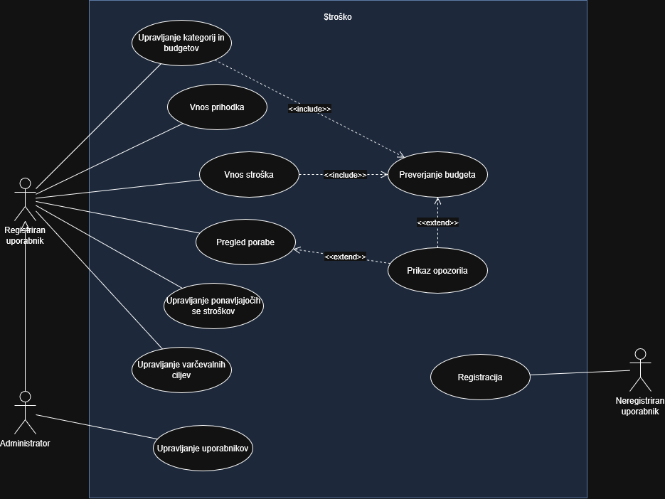

# 💸 $troško – tracker za stroške

> Spletna aplikacija za pregled nad osebnimi financami – namenjena študentom in mladim, ki prvič samostojno upravljajo s svojim denarjem.


---

## 📑 Kazalo

1. [Člani skupine](#-člani-skupine)
2. [Vizija projekta](#-vizija-projekta)
   - [Opis rešitve](#opis-rešitve)
   - [Ključne funkcionalnosti](#ključne-funkcionalnosti)
   - [Obseg rešitve in morebitne omejitve](#obseg-rešitve-in-morebitne-omejitve)
3. [Besednjak](#-besednjak)
4. [Diagram primerov uporabe](#-diagram-primerov-uporabe)
5. [Uporabljene tehnologije](#-uporabljene-tehnologije)
6. [Struktura projekta](#-struktura-projekta)
7. [Navodila za nameščanje in zagon](#-navodila-za-nameščanje-in-zagon)
8. [REST API](#-rest-api)
9. [Navodila za razvijalce](#-navodila-za-razvijalce)
10. [Standardi kodiranja](#-standardi-kodiranja)

---

## 👥 Člani skupine

| Ime in priimek | GitHub |
|---|---|
| Staša Despotović | [@stasadespotovic1](https://github.com/stasadespotovic1) |
| Nikola Mojsov | [@mojsov](https://github.com/mojsov) |
| Lea Bogoevska | [@leabogoevska26](https://github.com/leabogoevska26) |

---

## 🔭 Vizija projekta

Študenti in mladi, ki se prvič sami preživljajo, pogosto ne vedo, kam jim gre denar. Večjih stroškov, kot sta najemnina in naročnina za telefon, se zavedajo, drobni vsakodnevni stroški (kava, malica, prevoz, aplikacije) pa se neopazno naberejo. Ob koncu meseca jih zato pogosto preseneti, da jim je zmanjkalo denarja.

**$troško** želi ta problem rešiti s preprosto spletno aplikacijo, ki uporabniku v vsakem trenutku pokaže, **koliko je v tekočem mesecu že porabil, koliko mu še ostane in za kaj je denar porabil**. Aplikacija ga pravočasno opozori, ko se približa budgetu, in ga spodbuja k varčevanju. Naš cilj je, da uporabnik z nekaj sekundami vnosa na dan pridobi popoln pregled nad svojimi financami in sprejema premišljene odločitve, namesto da težave odkrije šele na koncu meseca.

### Opis rešitve

$troško je spletna aplikacija, sestavljena iz React odjemalca in Spring Boot zalednega sistema s PostgreSQL bazo. Nov obiskovalec si najprej **ustvari uporabniški račun**. Po prijavi vidi in ureja **samo svoje podatke**, zato lahko aplikacijo hkrati uporablja več uporabnikov.

Registriran uporabnik si ustvari svoje **kategorije** (hrana, prevoz, zabava, naročnine …) in jim po želji določi mesečni **budget**. Nastavi lahko tudi splošni **mesečni budget**. Nato sproti vnaša **stroške** in **prihodke**. Aplikacija iz vnesenih podatkov izračuna porabo po kategorijah in **preostanek** do konca meseca ter ju pregledno prikaže. Ob vsakem novem strošku sistem preveri, ali se poraba približuje budgetu, in uporabnika po potrebi **opozori**.

Stroške, ki se ponavljajo vsak mesec (najemnina, Netflix, Spotify …), uporabnik vnese le enkrat, sistem pa jih nato **samodejno** zabeleži ob pravem dnevu. Z **varčevalnimi cilji** lahko uporabnik spremlja, koliko je že privarčeval za večji nakup ali poletje.

**Administrator** skrbi za delovanje sistema: pregleduje uporabniške račune, jih lahko blokira, odblokira ali izbriše. Do finančnih podatkov uporabnikov nima dostopa.

#### Ključne funkcionalnosti

| Funkcionalnost | Opis | PU | Status |
|---|---|---|---|
| Registracija in prijava | Ustvarjanje uporabniškega računa in prijava z e-pošto in geslom; vsak uporabnik vidi samo svoje podatke | PU1 | 📝 |
| Kategorije | Ustvarjanje, urejanje in brisanje lastnih kategorij (hrana, prevoz, zabava, naročnine …) | PU2 | ✅ |
| Budget po kategorijah | Vsaka kategorija ima lahko svoj mesečni budget | PU2 | ✅ |
| Mesečni budget | Splošen mesečni budget, nastavljen na začetku meseca | PU2 | 🚧 |
| Vnos stroškov | Vsak zapis ima znesek, datum, kratek opis in kategorijo | PU3 | ✅ |
| Vnos prihodkov | Štipendija, študentsko delo, žepnina … | PU4 | 🚧 |
| Pregled porabe | Poraba v tekočem mesecu, preostanek in razporeditev po kategorijah | PU5 | 🚧 |
| Preverjanje budgeta in opozorila | Ob vsakem novem strošku sistem preveri porabo in uporabnika opozori ob približevanju (80 %) ali preseganju budgeta | PU6, PU7 | 🚧 |
| Ponavljajoči se stroški | Najemnina, telefon, Netflix, Spotify … se vnesejo enkrat in se samodejno upoštevajo vsak mesec | PU8 | 📝 |
| Varčevalni cilji | Npr. *300 € za poletje* – spremljanje napredka in koliko ostane za cilj na koncu meseca | PU9 | 📝 |
| Upravljanje uporabnikov | Administrator pregleduje, blokira, odblokira in briše uporabniške račune | PU10 | 📝 |

<sub>✅ implementirano · 🚧 v razvoju · 📝 načrtovano</sub>

### Obseg rešitve in morebitne omejitve

**V obsegu rešitve je:**

- registracija, prijava in odjava; ločeni podatki za vsakega uporabnika,
- ročni vnos, urejanje in brisanje stroškov, prihodkov in kategorij,
- nastavitev budgeta za posamezno kategorijo in splošnega mesečnega budgeta,
- mesečni pregled porabe, preostanka in razporeditve po kategorijah,
- opozorila v aplikaciji ob približevanju ali preseganju budgeta,
- mesečno ponavljajoči se stroški s samodejnim vnosom,
- varčevalni cilji z ročnimi vplačili in spremljanjem napredka,
- administracija uporabniških računov (pregled, blokiranje, brisanje).

**Omejitve (izven obsega te različice):**

- **Ni povezave z bankami ali karticami** – vsi stroški in prihodki se vnašajo ročno. Natančnost pregleda je zato odvisna od rednega vnašanja.
- **Ni deljenih računov ali stroškov** – vsak uporabnik ima svoje ločene finance; skupni stroški (npr. med cimri) niso podprti.
- **Prijava samo z e-pošto in geslom** – prijava prek Googla, Facebooka ipd. ni podprta.
- **Administrator nima vpogleda v finance uporabnikov** – upravlja samo račune, ne pa stroškov, prihodkov ali kategorij uporabnikov.
- **Ena valuta (EUR)** – pretvorbe med valutami niso podprte.
- **Ponavljanje samo na mesečni ravni** – tedenski ali letni ponavljajoči se stroški niso podprti.
- **Opozorila samo znotraj aplikacije** – ni e-poštnih ali push obvestil.
- **Samo spletna aplikacija** – ni namenske mobilne aplikacije (je pa vmesnik uporaben tudi v mobilnem brskalniku).
- **Brez investicij, kreditov in davkov** – aplikacija je namenjena spremljanju vsakodnevne porabe, ne celovitemu finančnemu načrtovanju.
- Uvoz/izvoz podatkov (CSV, PDF poročila) za zdaj ni načrtovan.

---

## 📚 Besednjak

| Izraz | Razlaga |
|---|---|
| **Neregistriran uporabnik** | Obiskovalec aplikacije, ki še nima uporabniškega računa. Lahko se samo registrira. |
| **Registriran uporabnik** | Uporabnik z uporabniškim računom, ki po prijavi spremlja svoje stroške, prihodke, budgete in varčevalne cilje. |
| **Administrator** | Registriran uporabnik s posebnimi pravicami, ki upravlja uporabniške račune. Do financ drugih uporabnikov nima dostopa. |
| **Uporabniški račun** | Podatki, s katerimi se uporabnik prijavi (e-pošta, geslo, ime). Vsi stroški, prihodki in kategorije pripadajo natanko enemu računu. |
| **Blokiran račun** | Uporabniški račun, ki ga je administrator onemogočil; prijava z njim ni mogoča, podatki pa ostanejo shranjeni. |
| **Strošek** (odhodek) | Posamezen izdatek uporabnika. Ima znesek, datum, kratek opis in natanko eno kategorijo. |
| **Prihodek** | Denar, ki ga uporabnik prejme (štipendija, plačilo študentskega dela, žepnina …). Ima znesek, datum, vir in opis. |
| **Vir prihodka** | Vrsta prihodka, npr. štipendija, študentsko delo, žepnina ali drugo. |
| **Kategorija** | Skupina, v katero uporabnik razvršča stroške (npr. hrana, prevoz, zabava, naročnine). Kategorije si uporabnik ustvari sam. |
| **Budget kategorije** | Največji znesek, ki ga uporabnik namerava v enem mesecu porabiti v določeni kategoriji. |
| **Mesečni budget** | Skupni znesek, ki ga uporabnik namerava porabiti v celotnem mesecu, ne glede na kategorijo. |
| **Poraba** | Vsota vseh stroškov v izbranem obdobju (mesecu) – skupno ali za posamezno kategorijo. |
| **Preostanek** | Znesek, ki uporabniku še ostane v mesecu: mesečni budget − poraba (če budget ni nastavljen: prihodki − poraba). |
| **Prag opozorila** | Delež porabljenega budgeta, pri katerem sistem uporabnika opozori – 80 % (približevanje) in 100 % (preseganje). |
| **Opozorilo** | Obvestilo, ki ga sistem prikaže, ko poraba v kategoriji ali mesecu doseže prag opozorila. |
| **Ponavljajoči se strošek** | Predloga za strošek, ki se ponovi vsak mesec na isti dan (najemnina, telefon, Netflix …). Iz nje sistem samodejno ustvari običajen strošek. |
| **Samodejni vnos** | Postopek, s katerim sistem na dan zapadlosti iz ponavljajočega se stroška ustvari nov strošek brez posredovanja uporabnika. |
| **Varčevalni cilj** | Znesek, ki ga želi uporabnik privarčevati za določen namen, po želji do določenega roka (npr. *300 € za poletje*). |
| **Vplačilo v cilj** | Znesek, ki ga uporabnik nameni varčevalnemu cilju in poveča privarčevani znesek. |
| **Napredek cilja** | Razmerje med privarčevanim in ciljnim zneskom, prikazano v odstotkih. |

---

## 🧩 Diagram primerov uporabe

Diagram prikazuje načrtovano različico aplikacije z vsemi ključnimi funkcionalnostmi.



<sub>Izvorna datoteka za urejanje v [draw.io](https://app.diagrams.net/): [`DPU.drawio`](DPU.drawio)</sub>

**Akterji**

| Akter | Opis |
|---|---|
| **Neregistriran uporabnik** | Obiskovalec brez računa, ki se lahko registrira. |
| **Registriran uporabnik** | Študent ali mlada oseba, ki po prijavi uporablja aplikacijo za spremljanje svojih financ. |
| **Administrator** | Specializacija registriranega uporabnika (generalizacija akterjev): lahko izvaja vse primere uporabe registriranega uporabnika, poleg tega pa upravlja uporabniške račune. |

**Primeri uporabe**

| ID | Primer uporabe | Akter | Status |
|---|---|---|---|
| PU1 | Registracija | Neregistriran uporabnik | 📝 |
| PU2 | Upravljanje kategorij in budgetov | Registriran uporabnik | ✅ kategorije in budget kategorije · 🚧 mesečni budget |
| PU3 | Vnos stroška | Registriran uporabnik | ✅ |
| PU4 | Vnos prihodka | Registriran uporabnik | 🚧 |
| PU5 | Pregled porabe | Registriran uporabnik | 🚧 |
| PU6 | Preverjanje budgeta | – (vključen v PU2 in PU3) | 🚧 |
| PU7 | Prikaz opozorila | – (razširja PU5 in PU6) | 🚧 |
| PU8 | Upravljanje ponavljajočih se stroškov | Registriran uporabnik | 📝 |
| PU9 | Upravljanje varčevalnih ciljev | Registriran uporabnik | 📝 |
| PU10 | Upravljanje uporabnikov | Administrator | 📝 |

**Povezave**

- **PU3 Vnos stroška «include» PU6 Preverjanje budgeta** – ob vsakem vnesenem strošku sistem vedno preveri porabo glede na budget.
- **PU2 Upravljanje kategorij in budgetov «include» PU6 Preverjanje budgeta** – ob vsaki spremembi budgeta kategorije ali mesečnega budgeta sistem vedno znova preveri, ali trenutna poraba že dosega nov budget.
- **PU7 Prikaz opozorila «extend» PU6 Preverjanje budgeta** – opozorilo se prikaže samo pod pogojem, da poraba doseže 80 % ali več budgeta.
- **PU7 Prikaz opozorila «extend» PU5 Pregled porabe** – ob odprtju pregleda porabe se opozorila prikažejo samo pod pogojem, da ima uporabnik neprebrana opozorila (npr. ker je bil strošek vnesen samodejno, ko ni bil prijavljen).
- **Administrator → Registriran uporabnik (generalizacija)** – administrator podeduje vse primere uporabe registriranega uporabnika.

> **Opomba:** Prijava ni prikazana kot samostojen primer uporabe, saj sama po sebi ni cilj uporabnika, temveč **predpogoj** za vse primere uporabe registriranega uporabnika in administratorja (navedena je v predpogojih podrobnih opisov).

📄 **Podroben opis vseh neimplementiranih primerov uporabe:** [`primeri_uporabe.md`](primeri_uporabe.md)

---

## 🛠 Uporabljene tehnologije

### Backend

| Tehnologija | Verzija | Namen |
|---|---|---|
| [Java (JDK)](https://adoptium.net/) | 21 | Programski jezik |
| [Spring Boot](https://spring.io/projects/spring-boot) | 4.1.1 | Ogrodje za REST API |
| Spring Web MVC | (Spring Boot 4.1.1) | REST kontrolerji |
| Spring Data JPA / Hibernate | (Spring Boot 4.1.1) | ORM in dostop do baze |
| [PostgreSQL JDBC driver](https://jdbc.postgresql.org/) | (Spring Boot 4.1.1) | Povezava s PostgreSQL |
| [Lombok](https://projectlombok.org/) | 1.18.48 | Zmanjšanje "boilerplate" kode (getterji, setterji …) |
| [springdoc-openapi](https://springdoc.org/) | 3.0.0 | Swagger UI in OpenAPI dokumentacija |
| [Maven](https://maven.apache.org/) (wrapper) | 3.10.0 | Upravljanje odvisnosti in gradnja |

### Frontend

| Tehnologija | Verzija | Namen |
|---|---|---|
| [React](https://react.dev/) | 19.3 | UI knjižnica |
| [TypeScript](https://www.typescriptlang.org/) | 6.0 | Tipiziran JavaScript |
| [Vite](https://vite.dev/) | 8.3 | Razvojni strežnik in gradnja |
| [@vitejs/plugin-react](https://github.com/vitejs/vite-plugin-react) | 6.1 | React podpora za Vite |
| [ESLint](https://eslint.org/) + typescript-eslint | 10.13 / 8.71 | Statična analiza kode |

### Podatkovna baza in orodja

| Orodje | Verzija | Namen |
|---|---|---|
| [PostgreSQL](https://www.postgresql.org/) | 16 ali novejši | Relacijska podatkovna baza |
| [Node.js](https://nodejs.org/) | 20.19+ ali 22.12+ | Izvajanje frontenda |
| Git + GitHub | – | Verzioniranje kode |
| IntelliJ IDEA / VS Code | – | Razvojno okolje |

---

## 🗂 Struktura projekta

```
Strosko/
├── backend/                         # Spring Boot REST API
│   ├── .mvn/wrapper/                # Maven wrapper (ni potrebna lokalna namestitev Mavena)
│   ├── src/
│   │   ├── main/
│   │   │   ├── java/si/um/feri/backend/
│   │   │   │   ├── BackendApplication.java   # Vstopna točka aplikacije
│   │   │   │   ├── vao/                      # Entitete (modeli podatkov)
│   │   │   │   │   ├── Kategorija.java
│   │   │   │   │   └── Strosek.java
│   │   │   │   ├── dao/                      # Repozitoriji (dostop do baze)
│   │   │   │   │   ├── KategorijaRepository.java
│   │   │   │   │   └── StrosekRepository.java
│   │   │   │   └── rest/                     # REST kontrolerji (API končne točke)
│   │   │   │       ├── InfoController.java
│   │   │   │       ├── KategorijaController.java
│   │   │   │       └── StrosekController.java
│   │   │   └── resources/
│   │   │       └── application.properties    # Konfiguracija (port, baza, JPA)
│   │   └── test/                             # Testi
│   ├── mvnw / mvnw.cmd              # Skripti za zagon Maven wrapperja
│   └── pom.xml                      # Maven odvisnosti in nastavitve gradnje
│
├── frontend/                        # React + TypeScript odjemalec
│   ├── public/                      # Statične datoteke (favicon, ikone)
│   ├── src/
│   │   ├── components/              # React komponente
│   │   │   ├── KategorijaForm.tsx   # Obrazec za dodajanje/urejanje kategorije
│   │   │   ├── KategorijaList.tsx   # Seznam kategorij
│   │   │   ├── StrosekForm.tsx      # Obrazec za dodajanje/urejanje stroška
│   │   │   └── StrosekList.tsx      # Seznam stroškov
│   │   ├── App.tsx                  # Glavna komponenta aplikacije
│   │   ├── api.ts                   # Klici na REST API (fetch)
│   │   ├── types.ts                 # TypeScript tipi (Strosek, Kategorija …)
│   │   ├── format.ts                # Pomožne funkcije za formatiranje (zneski, datumi)
│   │   ├── index.css                # Globalni stili
│   │   └── main.tsx                 # Vstopna točka React aplikacije
│   ├── index.html
│   ├── package.json                 # npm odvisnosti in skripte
│   ├── tsconfig*.json               # Nastavitve TypeScript prevajalnika
│   ├── eslint.config.js             # Nastavitve ESLint
│   └── vite.config.ts               # Nastavitve Vite
│
├── docs/                            # Projektna dokumentacija
│   ├── diagram-primerov-uporabe.drawio # Diagram primerov uporabe (izvor za draw.io)
│   ├── diagram-primerov-uporabe.png # Diagram primerov uporabe (slika)
│   ├── diagram-primerov-uporabe.svg # Diagram primerov uporabe (vektorski izvor)
│   └── primeri-uporabe.md           # Podroben opis primerov uporabe
│
└── README.md
```

### Razlaga map

**Backend** sledi slojni arhitekturi:

| Mapa | Vloga |
|---|---|
| `vao/` | *Value Access Objects* – JPA entitete, ki predstavljajo tabele v bazi (`Kategorija`, `Strosek`). |
| `dao/` | *Data Access Objects* – Spring Data JPA repozitoriji za CRUD operacije nad entitetami. |
| `rest/` | REST kontrolerji, ki sprejemajo HTTP zahteve, validirajo podatke in kličejo repozitorije. |
| `resources/` | Konfiguracijske datoteke aplikacije. |

**Frontend** je razdeljen na:

| Mapa / datoteka | Vloga |
|---|---|
| `components/` | Ponovno uporabne React komponente (obrazci, seznami). |
| `api.ts` | Edino mesto, kjer frontend komunicira z backendom. |
| `types.ts` | Skupni tipi, ki odražajo podatkovni model backenda. |

---

## 🚀 Navodila za nameščanje in zagon

### 1. Predpogoji

Pred začetkom namestite:

| Orodje | Preverjanje namestitve |
|---|---|
| **Java JDK 21** ([Temurin](https://adoptium.net/)) | `java -version` |
| **PostgreSQL 16+** ([prenos](https://www.postgresql.org/download/)) | `psql --version` |
| **Node.js 20.19+ / 22.12+** in npm ([prenos](https://nodejs.org/)) | `node -v` in `npm -v` |
| **Git** | `git --version` |

> 💡 Maven ni potrebno nameščati posebej – projekt vsebuje Maven wrapper (`mvnw`).
> Poskrbite, da je spremenljivka okolja `JAVA_HOME` nastavljena na JDK 21.

### 2. Kloniranje repozitorija

```bash
git clone https://github.com/stasadespotovic1/Strosko.git
cd Strosko
```

### 3. Vzpostavitev podatkovne baze

1. Zaženite PostgreSQL strežnik (privzeto na portu `5432`).
2. Ustvarite bazo `stroski`:

   ```bash
   psql -U postgres -c "CREATE DATABASE stroski;"
   ```

   ali preko pgAdmin: *Databases → Create → Database…* → ime `stroski`.

3. Tabel ni treba ustvarjati ročno – Hibernate jih ob zagonu ustvari/posodobi samodejno (`spring.jpa.hibernate.ddl-auto=update`).

### 4. Okoljske spremenljivke

Nastavitve backenda so v [`backend/src/main/resources/application.properties`](backend/src/main/resources/application.properties). Vsako lastnost lahko prepišete z okoljsko spremenljivko, zato **gesla za bazo ne vpisujte v repozitorij**, ampak ga nastavite lokalno:

| Spremenljivka | Privzeta vrednost | Opis |
|---|---|---|
| `SPRING_DATASOURCE_URL` | `jdbc:postgresql://localhost:5432/stroski` | Naslov baze |
| `SPRING_DATASOURCE_USERNAME` | `postgres` | Uporabnik baze |
| `SPRING_DATASOURCE_PASSWORD` | – | Geslo uporabnika baze |
| `SERVER_PORT` | `8100` | Port backenda |

**Windows (PowerShell):**

```powershell
$env:SPRING_DATASOURCE_USERNAME = "postgres"
$env:SPRING_DATASOURCE_PASSWORD = "vase_geslo"
```

**Linux / macOS:**

```bash
export SPRING_DATASOURCE_USERNAME=postgres
export SPRING_DATASOURCE_PASSWORD=vase_geslo
```

> V IntelliJ IDEA jih lahko nastavite tudi v *Run → Edit Configurations → Environment variables*.

### 5. Zagon backenda

```bash
cd backend
./mvnw spring-boot:run        # Linux / macOS
mvnw.cmd spring-boot:run      # Windows
```

Backend teče na **http://localhost:8100/api/v1**.

| Povezava | Opis |
|---|---|
| http://localhost:8100/api/v1/info | Preverjanje, ali backend deluje |
| http://localhost:8100/api/v1/swagger-ui/index.html | Swagger UI – interaktivna dokumentacija API-ja |

### 6. Zagon frontenda

V novem terminalu:

```bash
cd frontend
npm install       # samo prvič oz. ob spremembi odvisnosti
npm run dev
```

Frontend teče na **http://localhost:5173**.

> Naslov backenda je nastavljen v [`frontend/src/api.ts`](frontend/src/api.ts) (konstanta `BASE`).

### Uporabne npm skripte

| Ukaz | Opis |
|---|---|
| `npm run dev` | Zažene razvojni strežnik z "hot reload" |
| `npm run build` | Preveri tipe in zgradi produkcijsko verzijo v `dist/` |
| `npm run preview` | Lokalno prikaže produkcijsko verzijo |
| `npm run lint` | Preveri kodo z ESLint |

### Težave pri zagonu

| Težava | Rešitev |
|---|---|
| `Connection refused` na `localhost:5432` | PostgreSQL ne teče – zaženite storitev. |
| `database "stroski" does not exist` | Ustvarite bazo (korak 3). |
| `password authentication failed` | Preverite `SPRING_DATASOURCE_USERNAME` / `SPRING_DATASOURCE_PASSWORD`. |
| `Port 8100 already in use` | Ustavite drug proces ali nastavite `SERVER_PORT`. |
| Napake CORS v brskalniku | Preverite, da backend teče in da se `BASE` v `api.ts` ujema s portom. |

---

## 🔌 REST API

Osnovni URL: `http://localhost:8100/api/v1`

| Metoda | Končna točka | Opis |
|---|---|---|
| `GET` | `/info` | Informacija o delovanju strežnika |
| `GET` | `/kategorije` | Seznam vseh kategorij |
| `GET` | `/kategorije/{id}` | Ena kategorija |
| `POST` | `/kategorije` | Nova kategorija |
| `PUT` | `/kategorije/{id}` | Posodobitev kategorije |
| `DELETE` | `/kategorije/{id}` | Brisanje kategorije |
| `GET` | `/stroski` | Seznam vseh stroškov |
| `GET` | `/stroski/{id}` | En strošek |
| `POST` | `/stroski` | Nov strošek |
| `PUT` | `/stroski/{id}` | Posodobitev stroška |
| `DELETE` | `/stroski/{id}` | Brisanje stroška |

<details>
<summary>Primer zahteve – nov strošek</summary>

```http
POST /api/v1/stroski
Content-Type: application/json

{
  "opis": "Kosilo v menzi",
  "znesek": 4.50,
  "datum": "2026-11-04",
  "kategorija": { "id": 1 }
}
```

</details>

Podroben opis vseh modelov in odgovorov je na voljo v **Swagger UI**.

---

## 👩‍💻 Navodila za razvijalce

### Delo z GitHub repozitorijem

Uporabljamo poenostavljen **feature-branch workflow**:

```
main  ←── Pull Request ←── feature/ponavljajoci-stroski
                       ←── fix/napaka-pri-brisanju
```

1. **Posodobite `main`:**

   ```bash
   git checkout main
   git pull origin main
   ```

2. **Ustvarite novo vejo** za vsako nalogo:

   ```bash
   git checkout -b feature/kratek-opis
   ```

   | Predpona | Uporaba |
   |---|---|
   | `feature/` | Nova funkcionalnost |
   | `fix/` | Popravek napake |
   | `docs/` | Dokumentacija |
   | `refactor/` | Preoblikovanje kode brez spremembe delovanja |

3. **Pogosto commitajte** z jasnimi sporočili (glej spodaj).

4. **Potisnite vejo** in odprite **Pull Request** v `main`:

   ```bash
   git push -u origin feature/kratek-opis
   ```

5. Vsaj **en član ekipe pregleda** PR, preden se ga združi.
6. Po združitvi vejo izbrišete.

> ⚠️ Neposrednega pushanja v `main` ne izvajamo.

### Sporočila commitov

Uporabljamo obliko [Conventional Commits](https://www.conventionalcommits.org/):

```
<tip>: <kratek opis v velelniku>
```

| Tip | Primer |
|---|---|
| `feat` | `feat: dodaj varčevalne cilje` |
| `fix` | `fix: popravi izračun preostanka budgeta` |
| `docs` | `docs: posodobi navodila za zagon` |
| `refactor` | `refactor: loči validacijo v servis` |
| `style` | `style: uredi zamike v StrosekForm` |
| `test` | `test: dodaj teste za KategorijaController` |
| `chore` | `chore: posodobi odvisnosti` |

### Kaj ne sodi v repozitorij

- gesla in drugi skrivni podatki (uporabite okoljske spremenljivke),
- generirane datoteke: `backend/target/`, `frontend/node_modules/`, `frontend/dist/`,
- nastavitve IDE (`.idea/`, `.vscode/`),
- arhivi in osebne datoteke (`*.zip` …).

### Preverjanje pred Pull Requestom

```bash
# backend
cd backend && ./mvnw test

# frontend
cd frontend && npm run lint && npm run build
```

---

## 📏 Standardi kodiranja

### Splošno

- Imena domenskih pojmov so v **slovenščini** (`Strosek`, `Kategorija`, `znesek`, `budzet`), tehnični pojmi pa ostanejo v angleščini (`Controller`, `Repository`, `Form`, `List`).
- Brez šumnikov v imenih razredov, spremenljivk in datotek (`Strosek`, ne `Strošek`).
- Zamik: **4 presledki** v Javi, **2 presledka** v TypeScriptu.
- Koda mora biti brez opozoril prevajalnika in lintra.
- Komentarji naj pojasnjujejo *zakaj*, ne *kaj*.

### Backend (Java / Spring)

| Pravilo | Primer |
|---|---|
| Razredi v `PascalCase` | `StrosekController` |
| Metode in spremenljivke v `camelCase` | `nastaviKategorijo()` |
| Konstante v `UPPER_SNAKE_CASE` | `MAX_ZNESEK` |
| Paketi v malih črkah | `si.um.feri.backend.rest` |
| Entitete v `vao`, repozitoriji v `dao`, kontrolerji v `rest` | – |
| Repozitorij se imenuje `<Entiteta>Repository` | `KategorijaRepository` |
| Kontroler se imenuje `<Entiteta>Controller` | `KategorijaController` |
| Odvisnosti vbrizgamo preko konstruktorja | `private final StrosekRepository dao;` |
| Za getterje/setterje uporabimo Lombok | `@Data`, `@NoArgsConstructor` |
| REST poti so samostalniki v množini | `/stroski`, `/kategorije` |
| Pravilne HTTP statusne kode | `201 Created`, `404 Not Found`, `400 Bad Request` |

### Frontend (React / TypeScript)

| Pravilo | Primer |
|---|---|
| Samo funkcijske komponente in hooki | `function StrosekList() { … }` |
| Ena komponenta na datoteko, ime v `PascalCase` | `StrosekForm.tsx` |
| Funkcije in spremenljivke v `camelCase` | `getStroski`, `createKategorija` |
| Vsi klici na API so v `api.ts` | – |
| Tipi so v `types.ts`, brez uporabe `any` | `Strosek`, `StrosekInput` |
| Uporaba `async/await` namesto `.then()` | – |
| Koda mora prestati `npm run lint` | – |

---

<p align="center">Projekt pri predmetu <b>Razvoj informacijskih sistemov (RIS)</b> · FERI, Univerza v Mariboru</p>